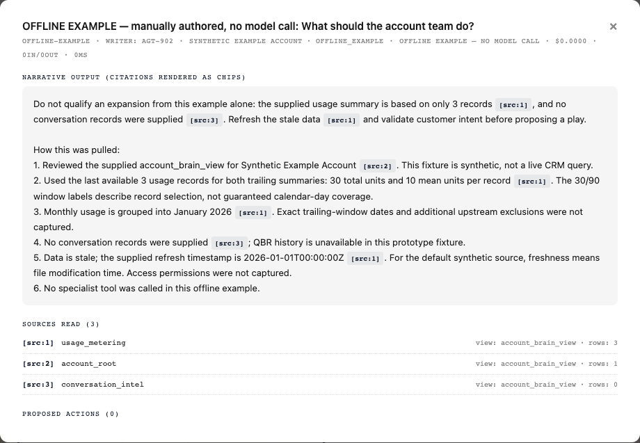

# Account Brain: How this was pulled

Account Brain now has a prompt-guided response convention: lead with the insight
and recommendation, then end `narrative_output` with a short, numbered
**How this was pulled:** summary. Existing citations remain in place.

The prompt includes a preparation note explaining the actual usage-window,
health-snapshot, payment-event, conversation, and derived-signal rules. The
summary must distinguish record counts from calendar days, supplied summaries
from raw data, and synthetic inputs from live systems. It must disclose missing
information instead of inventing queries, filters, permissions, or counts.

This changes neither the response schema nor the gallery. It does not add a
validator for methodology accuracy or independently verify model claims.
Historical answers are not rewritten.

## Offline checks

With the prototype's `anthropic` dependency installed:

```bash
python -m unittest discover -s prototype/tests -v
python prototype/eval/calibration_probes.py
```

These check prompt context, normal/short/empty usage history, irregular health
dates, payment counting across truncated recent events, and the example's
citations. They require no API key and make no model calls. They do not establish
live-model compliance with the response convention.

## Illustrative example

The fixture at `prototype/tests/fixtures/account_methodology_example.json`
is **manually authored synthetic data**, not an AI answer or a passing eval run.
It includes its input view so counts can be checked against the preparation
functions. It is separate from the historical samples in `eval/samples/`.



To preview it without changing gallery files, serve the repo with
`python -m http.server 8000`, open `http://localhost:8000/gtm_os_explainer.html`,
and run the following in the browser's developer console:

```js
const example = await fetch('prototype/tests/fixtures/account_methodology_example.json').then(r => r.json());
BRAIN_STATE.data = example;
openBrainModal('OFFLINE-EXAMPLE');
```

This temporarily displays only the example modal. Reload the page to restore
the normal page state. The modal labels the example as manually authored and
shows that no model call was made.
